# Hướng dẫn sử dụng Creative Tracker

Chưa cài? Xem **[Hướng dẫn cài đặt](HUONG-DAN-CAI-DAT.md)**. Mở tool: nhấp đúp `mo-tool.command` → trình duyệt mở **http://127.0.0.1:8770**.

Tool theo dõi quảng cáo của **đối thủ** trên Meta Ad Library (trang công khai của Facebook) và trả lời: mỗi ngày đối thủ tung bao nhiêu **creative mới**, bao nhiêu **bộ mới**, page đó của ai. Tất cả ảnh dưới đây chụp từ tool thật; số đỏ ①②③ chỉ đúng nút đang nói tới.

---

## 1. Hai tab và thanh lọc chung

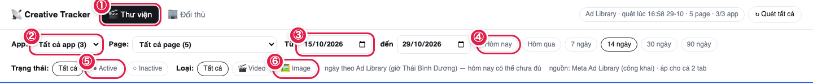

| Số | Là gì |
|---|---|
| ① | 2 tab: **🎬 Thư viện** (xem từng creative) và **🏢 Đối thủ** (danh sách app → page, nút quét) |
| ② | Lọc theo **App** (và ô **Page** bên cạnh) |
| ③ | Khoảng ngày **Từ – đến** |
| ④ | Chọn nhanh khoảng ngày: **Hôm nay · Hôm qua · 7 · 14 · 30 · 90 ngày** |
| ⑤ | Lọc **trạng thái**: Tất cả · ● Active (còn chạy) · ○ Inactive (đã tắt) |
| ⑥ | Lọc **loại**: Tất cả · 🎬 Video · 🖼 Image |

Thanh lọc này áp cho **cả 2 tab**. Trình duyệt tự nhớ lựa chọn trạng thái / loại cho lần sau.

> Ngày trong tool là **ngày theo Ad Library = giờ Thái Bình Dương (Los Angeles)**, chậm hơn giờ Việt Nam 14–15 tiếng. Vì vậy "Hôm nay" có thể chưa đủ ngày.

---

## 2. Thêm đối thủ (app mới + page của nó)

**Muốn thêm một đối thủ mới** → tab **🏢 Đối thủ** → bấm **＋ Thêm đối thủ** (số ① ở ảnh mục 4).

**Bước ①: nhập app**

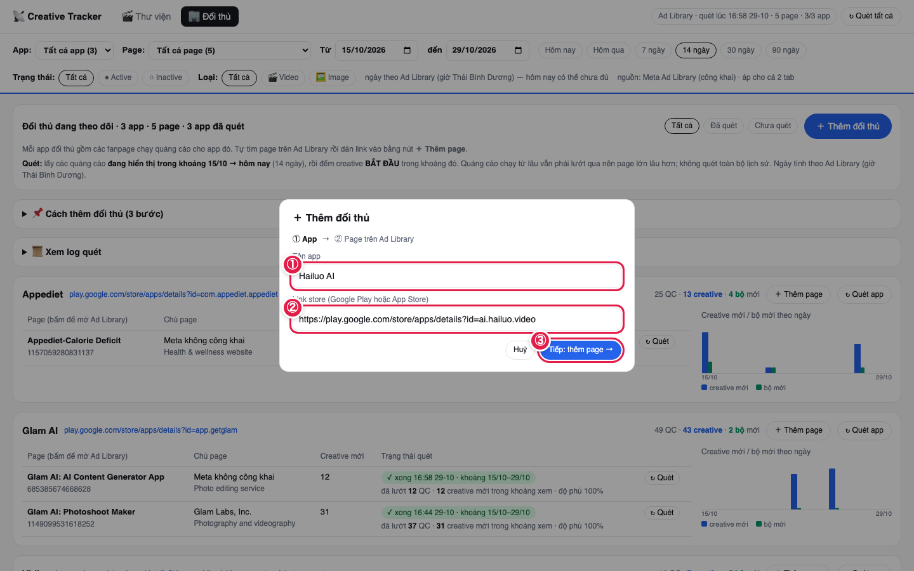

① gõ **tên app** (tuỳ đặt) → ② dán **link store** (Google Play hoặc App Store) → ③ bấm **Tiếp: thêm page →**.

**Bước ②: tự tìm page của app trên Ad Library, rồi dán link**

Cách tìm link page:
1. Mở [facebook.com/ads/library](https://www.facebook.com/ads/library/), chọn **All** và **All ads**, gõ tên page hoặc tên app trong "ngoặc kép":
   
2. Bấm vào **tên page** trên một quảng cáo. Trang riêng của page mở ra; **copy link trên thanh địa chỉ** (link có chữ `view_all_page_id=`):
   
3. **Cẩn thận trùng tên:** `Hailuo AI APP` và `Hailuo ai app` là 2 page khác nhau. Bấm **See ad details** trên vài quảng cáo, kiểm link tải có về **đúng app** không.

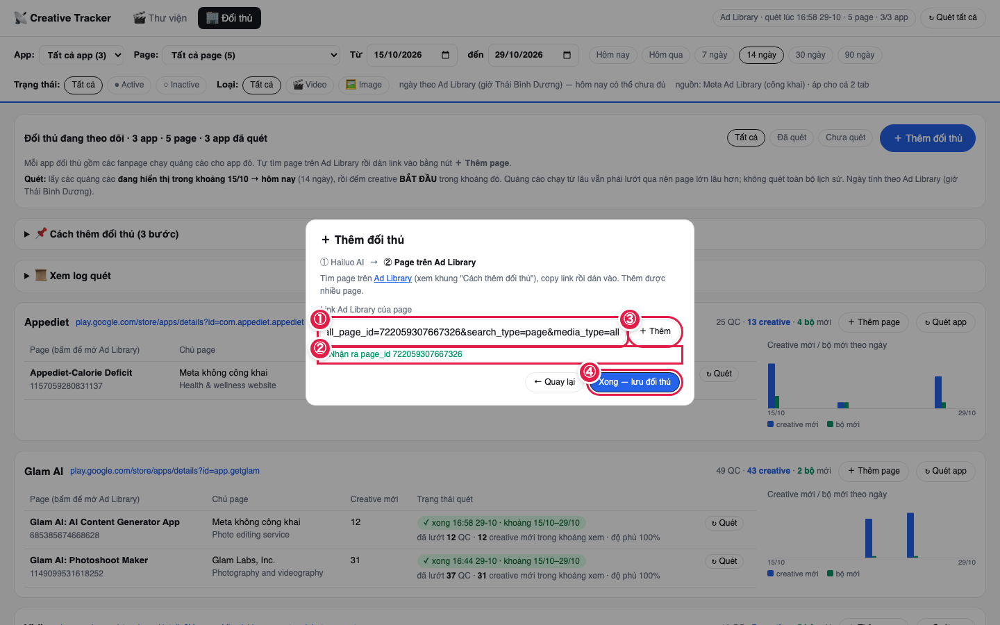

① dán link vào ô → ② thấy **"✓ Nhận ra page_id …"** là link đúng → ③ bấm **＋ Thêm** (thêm được nhiều page, mỗi lần một link) → ④ bấm **Xong — lưu đối thủ**.

Thấy app mới hiện trong tab Đối thủ, các page ghi **"chưa quét"**. Danh sách được lưu vào file `doi_thu.csv` trong thư mục tool.

## 3. Thêm page cho app đã có

**Muốn thêm page cho app đã có** → bấm **＋ Thêm page** trên thẻ app (số ③ ở ảnh mục 4).

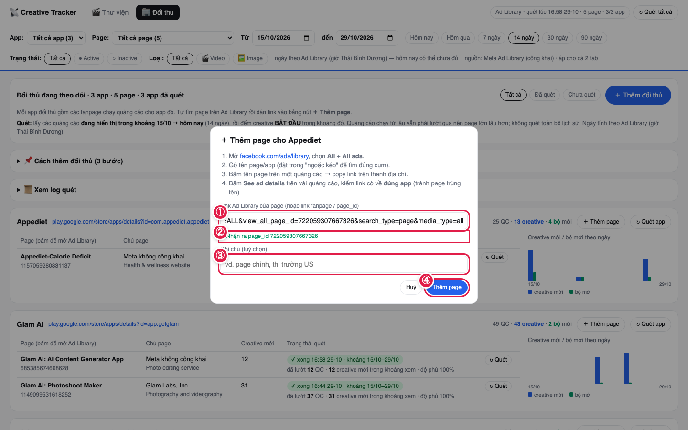

① dán link Ad Library của page (link fanpage hoặc page_id cũng được) → ② kiểm dòng **✓ Nhận ra page_id** → ③ ghi chú tuỳ ý → ④ bấm **Thêm page**.

---

## 4. Quét

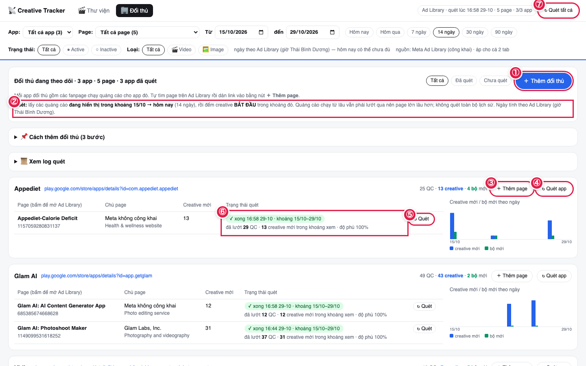

| Số | Là gì |
|---|---|
| ① | **＋ Thêm đối thủ** (mục 2) |
| ② | Dòng chữ cho biết **lần quét sẽ lấy khoảng ngày nào** (theo ô "Từ" trên thanh lọc) |
| ③ | **＋ Thêm page** cho app này (mục 3) |
| ④ | **↻ Quét app**: quét mọi page của app này |
| ⑤ | **↻ Quét** trên một dòng: chỉ quét page đó |
| ⑥ | Cột **Trạng thái quét** của page |
| ⑦ | **↻ Quét tất cả**: quét mọi page của mọi app |

**Muốn quét** → chọn khoảng ngày trên thanh lọc (mặc định 14 ngày) → bấm ④, ⑤ hoặc ⑦ → các page vào **hàng đợi**, quét lần lượt từng page (nghỉ 8–15 giây giữa các page).

**Quét như thế nào:** tool mở trang Ad Library của page, lấy **các quảng cáo đang hiển thị trong khoảng ngày bạn chọn**, rồi đếm creative **bắt đầu chạy** trong khoảng đó. Tool không quét toàn bộ lịch sử. Thời gian quét:

| Page có trong khoảng | Mỗi page mất |
|---|---|
| ≤ 30 quảng cáo | ~10–15 giây |
| ~100 quảng cáo | ~40–70 giây |
| ~1.100 quảng cáo | ~4–5 phút |
| vài nghìn quảng cáo | > 10 phút (tool báo "chưa lướt hết") |

### Đang quét trông thế nào

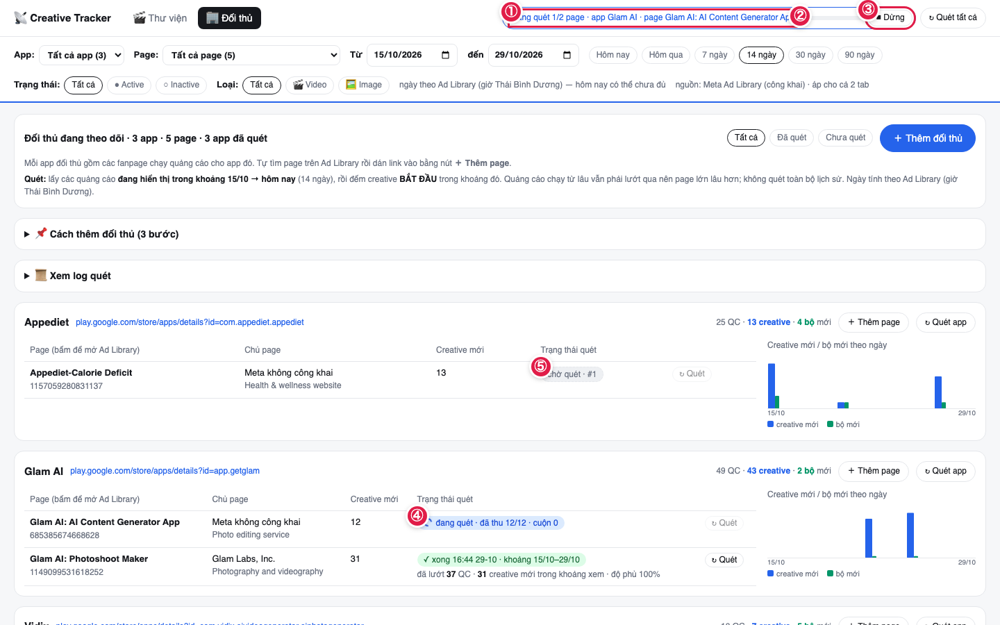

① góc trên ghi **"Đang quét 1/2 page · app … · page …"** → ② thanh tiến độ → ③ nút **⏹ Dừng** → ④ page đang quét: **"đang quét · đã thu 12/12 · cuộn 0"** → ⑤ page đang chờ: **"chờ quét · #1"** (số thứ tự trong hàng đợi).

Quét xong page nào thì số của page đó cập nhật ngay, không chờ cả lượt. Bấm **⏹ Dừng**: page đang quét bị bỏ dở, các page đã xong **giữ nguyên số**.

### Đọc cột Trạng thái quét

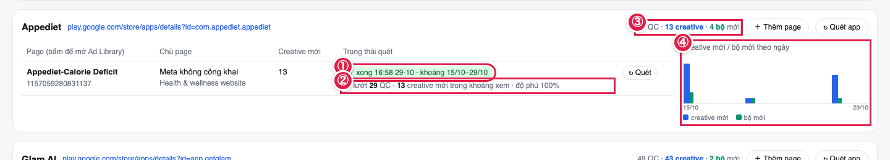

① **"✓ xong 16:58 29-10 · khoảng 15/10–29/10"**: giờ quét xong và khoảng ngày đã quét → ② **"đã lướt 29 QC · 13 creative mới trong khoảng xem · độ phủ 100%"** → ③ tổng của app → ④ biểu đồ creative mới (xanh dương) / bộ mới (xanh lá) theo ngày.

| Bạn thấy | Nghĩa |
|---|---|
| `chưa quét` | Page chưa quét lần nào. Bấm ↻ Quét. |
| `chờ quét · #2` | Đang xếp hàng, đứng thứ 2. |
| `đang quét · đã thu 59/113 · cuộn 2` | Đang lướt, đã đọc 59 trên 113 quảng cáo. |
| `✓ xong …` (xanh) | Quét đủ. |
| `✓ xong …` + `⚠ không biết tổng — Ad Library không báo số, không phải lỗi` | Quét xong nhưng Ad Library không cho biết tổng số để so độ phủ. Số vẫn dùng được. |
| `⚠ xong …` + `chưa lướt hết (93%)` | Page quá lớn, chạm giới hạn cuộn; số có thể thiếu một ít. |
| `⚠ … khoảng xem bắt đầu trước dd/mm — bấm ↻ Quét để lấy thêm` | Bạn đang xem khoảng dài hơn khoảng đã quét. Bấm ↻ Quét để quét đủ khoảng mới. |
| `⚠ lỗi: …` | Lần quét đó hỏng (ví dụ Facebook đòi đăng nhập). Chờ một lúc rồi quét lại. |
| `⏹ đã dừng` | Bạn bấm Dừng lúc page này đang quét. |

**Xem log chi tiết** → mở khung **📜 Xem log quét** ①:

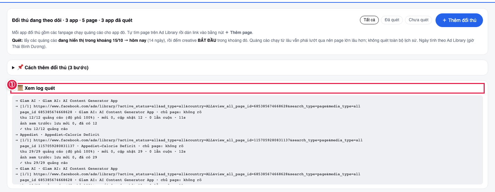

---

## 5. Xem Thư viện

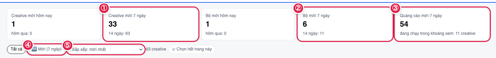

① creative mới 7 ngày (dưới ghi 14 ngày) → ② bộ mới 7 ngày → ③ quảng cáo mới 7 ngày → ④ chip **🆕 Mới (7 ngày)**: chỉ hiện creative mới → ⑤ **Sắp xếp**: mới nhất / nhiều quảng cáo dùng chung nhất / cũ nhất.

### Một thẻ creative

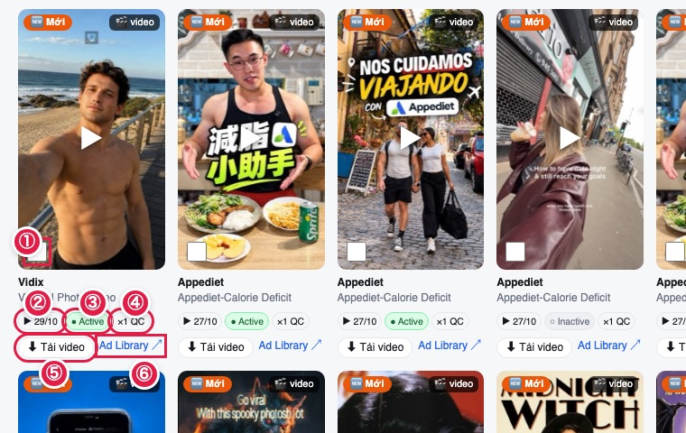

① ô chọn (để tải nhiều) → ② **▶ 29/10**: ngày bắt đầu chạy → ③ **● Active** (còn chạy) hoặc **○ Inactive** (đã tắt) → ④ **×1 QC**: số quảng cáo dùng chung creative này → ⑤ **⬇ Tải video** → ⑥ **Ad Library ↗**: mở đúng quảng cáo trên Ad Library.

### Xem video

**Muốn xem** → bấm vào ảnh của thẻ → hộp xem mở ra:

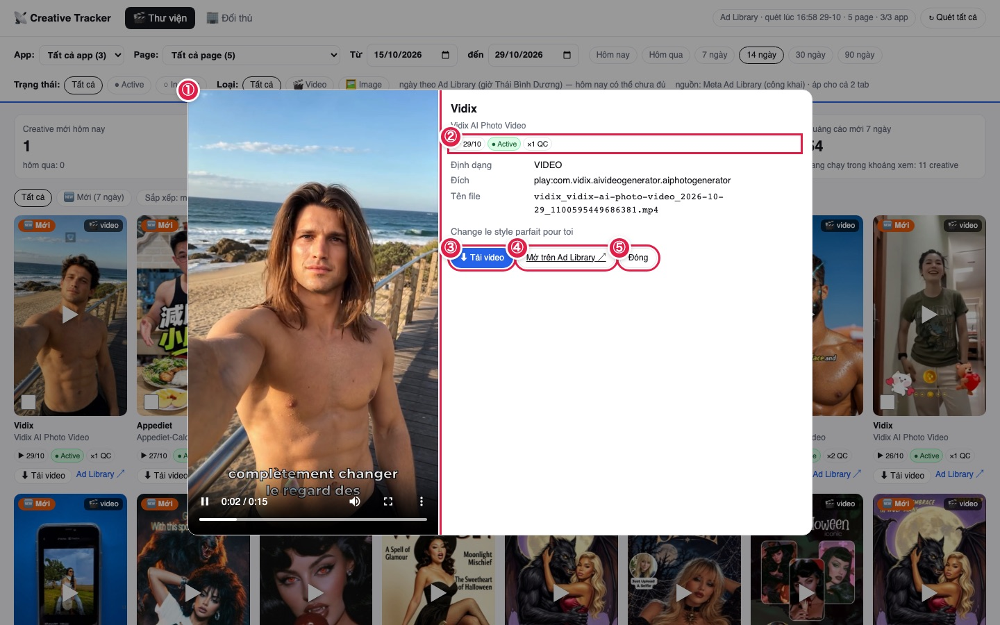

① video phát ngay → ② ngày bắt đầu / trạng thái / số QC → ③ **⬇ Tải video** → ④ **Mở trên Ad Library** → ⑤ **Đóng** (hoặc phím Esc).

### Tải một video / tải nhiều video (zip)

- **Tải 1 video** → bấm **⬇ Tải video** trên thẻ. File về thư mục Downloads, tên dạng `app_page_ngày-bắt-đầu_id.mp4`.
- **Tải nhiều** →

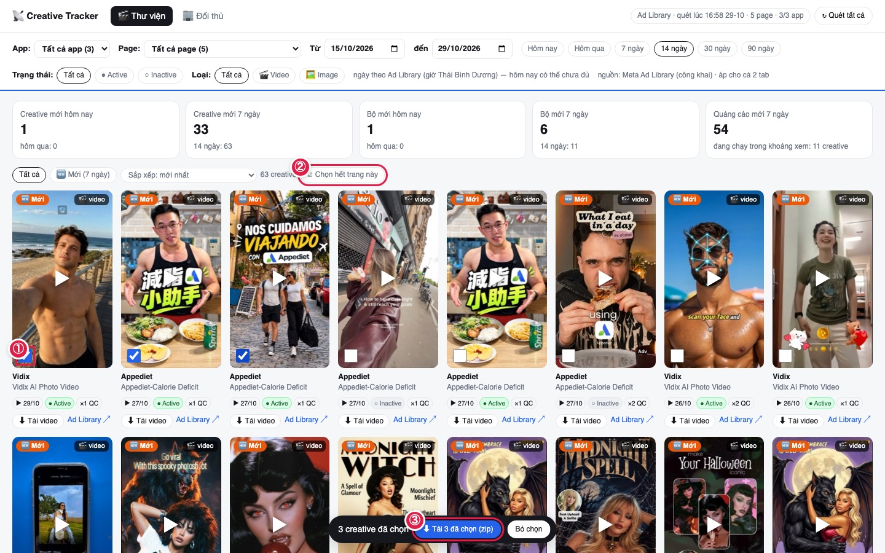

① tick ô góc thẻ (tick nhiều thẻ) hoặc ② bấm **☑ Chọn hết trang này** → ③ bấm **⬇ Tải N đã chọn (zip)** ở đáy trang → được 1 file `.zip`.

Link video của Facebook **hết hạn sau ~4,5 ngày**. Bấm tải mà link đã hết hạn thì tool **tự quét lại page đó** để lấy link mới (mất thêm 10 giây tới vài phút), rồi tải.

---

## 6. Đọc số: quảng cáo mới, creative mới, bộ mới

| Cột | Đếm gì |
|---|---|
| **Quảng cáo mới** | số quảng cáo bắt đầu chạy trong ngày |
| **Creative mới** | số **nội dung** mới. Meta tự gom các quảng cáo dùng chung một nội dung ("N ads use this creative"); 30 quảng cáo chung 1 video = **1 creative**. Mỗi creative chỉ tính **một lần**, vào ngày nó chạy sớm nhất. |
| **Bộ mới** | các creative mới **cùng ngày** và **cùng đích** (cùng app trên store, hoặc cùng website) = 1 bộ, tức là 1 lần "tung" creative |

**Ví dụ số thật** (Clash of Clans, ngày 23/10/2026): 80 quảng cáo mới → **28 creative** mới → **2 bộ** mới (1 bộ cho App Store, 1 bộ cho Google Play).

- **Active / Inactive**: creative **Active** khi còn ít nhất 1 quảng cáo của nó đang chạy (theo lần quét gần nhất).
- **Video / Image**: creative là **Video** khi có ít nhất 1 quảng cáo dạng video. Quảng cáo DCO, carousel, nhiều ảnh: có video thì tính Video, không thì tính Image.
- **Độ phủ** = số quảng cáo tool đọc được / số Ad Library báo. Dưới 98% thì số có thể thiếu.
- **"Đã lướt N QC · M creative mới"**: N là mọi quảng cáo đang hiển thị trong khoảng (kể cả chạy từ lâu), M là creative **mới bắt đầu** trong khoảng xem. N lớn mà M nhỏ là bình thường.

---

## 7. Xuất CSV (mở bằng Excel / Numbers)

Quét xong trên trang web, muốn có file CSV: mở Terminal ở thư mục tool (Bước 4 của hướng dẫn cài đặt) rồi gõ
```bash
.venv/bin/ctal report
```
Lệnh này không cần mạng, chạy vài giây, ghi vào thư mục `out/` trong thư mục tool (mặc định 14 ngày gần nhất; muốn 30 ngày: `.venv/bin/ctal report --days 30`):

| File | Nội dung |
|---|---|
| `out/tong-hop-theo-app.csv` | mỗi app × page × ngày: quảng cáo mới, creative mới, bộ mới; dòng `TỔNG APP` cho từng app |
| `out/<page_id>-daily.csv` | 1 page, mỗi ngày 1 dòng |
| `out/<page_id>-bo.csv` | mỗi bộ mới: ngày, đích, số creative, ID quảng cáo |

Mở thư mục `out` bằng Finder, nhấp đúp file `.csv` để mở bằng Excel hoặc Numbers (tiếng Việt hiển thị đúng).

## 8. Quét hằng ngày (tuỳ chọn)

Muốn máy tự quét mỗi sáng lúc 9:00 (máy phải đang bật):
```bash
crontab -e
```
Thêm dòng (sửa đường dẫn cho đúng thư mục tool của bạn), lưu lại:
```
0 9 * * * cd ~/Documents/creative-tracker-adlibrary && .venv/bin/ctal scan >> scan.log 2>&1
```

---

## 9. Giới hạn và câu hỏi thường gặp

**Chọn "Hôm nay" rồi bấm Quét, có phải chỉ quét creative hôm nay không?**
Số đếm và thẻ hiển thị thì **có**: chỉ tính creative **bắt đầu** hôm nay. Nhưng tool vẫn phải **lướt qua mọi quảng cáo đang hiển thị hôm nay**, kể cả quảng cáo chạy từ lâu, vì Ad Library không lọc được theo ngày bắt đầu. Vì vậy cột trạng thái ghi 2 số riêng, ví dụ "đã lướt 1510 QC · 6 creative mới".

**Vì sao chọn "Hôm qua" mà Thư viện trống?**
Hôm đó có quảng cáo mới, nhưng tất cả **dùng lại creative cũ** (đã chạy từ trước). Trang ghi rõ: "Có N quảng cáo mới … đều dùng lại creative cũ". Chọn khoảng dài hơn để xem các creative đó.

**Vì sao page lớn quét lâu?**
Xem bảng thời gian ở mục 4. Page vài nghìn quảng cáo nên để quét qua đêm.

**Có chi tiêu, lượt hiển thị không?**
Không. Ad Library chỉ công bố các số này cho quảng cáo ở EU/UK hoặc quảng cáo chính trị.

**Ảnh, video lưu ở đâu?**
Ảnh xem trước tự lưu vào `data/thumbs/` lúc quét (~23 KB/ảnh). Video **không** tải sẵn (1 video ~5 MB); chỉ tải khi bạn bấm.

**Quét lại có bị nhân đôi số không?**
Không. Quét lại cùng page thì cập nhật, không nhân đôi.

**Bị Facebook chặn?**
Tool cố ý đi chậm và không đăng nhập. Nếu thấy `⚠ lỗi: Facebook đòi đăng nhập` thì chờ vài giờ rồi quét lại.
