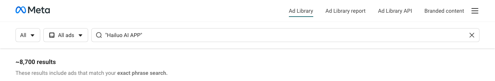
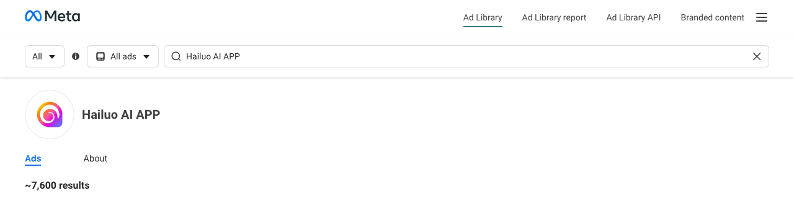

# Creative Tracker — bản Ad Library (cơ bản)

Bạn lập **danh sách đối thủ**: mỗi app, kèm các fanpage chạy quảng cáo cho app đó (tự tìm trên Ad Library rồi dán link vào). Với mỗi page, tool trả lời 3 câu:

1. **Page này của ai?** Tên page, page_id, tổ chức chịu trách nhiệm (Meta xác nhận), ngành, lượt thích, Instagram, ngày tạo page, quốc gia của người quản lý.
2. **Mỗi ngày có bao nhiêu creative mới?**
3. **Mỗi ngày có bao nhiêu bộ mới?**

Dữ liệu lấy từ trang công khai [Meta Ad Library](https://www.facebook.com/ads/library/): **không cần đăng nhập, không cần token API**. Tool chạy hoàn toàn trên máy bạn. Kết quả ra file CSV và một trang HTML mở thẳng bằng trình duyệt; không có server, không có domain.

---

## Cài đặt (macOS)

Cần **Python 3.10 trở lên**. Kiểm bằng `python3 --version`. Chưa có thì cài: `brew install python`.

```bash
git clone https://github.com/namhd-SG/creative-tracker-adlibrary.git
cd creative-tracker-adlibrary
python3 -m venv .venv
source .venv/bin/activate
pip install -e .
playwright install chromium     # tải trình duyệt dùng để đọc Ad Library (~150 MB, chỉ lần đầu)
```

Kiểm cài xong: `ctal --help`.

> Mở terminal mới thì chạy lại `cd creative-tracker-adlibrary && source .venv/bin/activate` trước khi dùng `ctal`.

## Thêm đối thủ

Cấu trúc: **app đối thủ → các page của app đó**. Danh sách nằm trong một file `doi_thu.csv` (mở được bằng Excel/Numbers), 4 cột: `app, link_store, link_ad_library, ghi_chu`. Mỗi page một dòng. Lần chạy đầu, tool tạo `doi_thu.csv` từ danh sách mẫu `doi_thu.mau.csv` (vài app có sẵn để thử); bạn sửa hoặc xoá tuỳ ý.

**1. Thêm app** (tên tuỳ đặt + link store):

```bash
ctal app add "Hailuo AI" "https://play.google.com/store/apps/details?id=ai.hailuo.video"
```

**2. Tìm page của app trên Ad Library**

Mở [facebook.com/ads/library](https://www.facebook.com/ads/library/), chọn **All** (quốc gia) và **All ads**. Gõ tên page hoặc tên app vào ô tìm kiếm. Đặt trong ngoặc kép để tìm đúng cụm, ví dụ `"Hailuo AI APP"`.



Trong kết quả, bấm vào **tên page** trên một quảng cáo, sẽ mở ra trang riêng của page đó:



Copy **link trên thanh địa chỉ**. Link đúng có dạng `…/ads/library/?…view_all_page_id=722059307667326…`.

⚠ **Trùng tên là chuyện thường:** `Hailuo AI APP` và `Hailuo ai app` là hai page khác nhau. Trước khi thêm, bấm **See ad details** trên vài quảng cáo của page, kiểm nút tải/link có trỏ về **đúng app** (đúng link store) không.

**3. Dán link vào app:**

```bash
ctal page add "Hailuo AI" "https://www.facebook.com/ads/library/?active_status=all&ad_type=all&country=ALL&view_all_page_id=722059307667326&search_type=page&media_type=all"
```

Ngoài link Ad Library, lệnh này cũng nhận link fanpage (`https://www.facebook.com/<tên>`) hoặc page_id trần. Thêm `--note "..."` để ghi chú.

**4. Xem danh sách:** `ctal list`

## Quét

```bash
ctal scan                          # quét mọi page trong doi_thu.csv rồi xuất báo cáo tổng hợp
ctal scan --app "Hailuo AI"        # chỉ quét các page của 1 app
ctal scan https://www.facebook.com/ClashofClans   # quét lẻ 1 page, không thêm vào danh sách
```

Tool tự nghỉ 8–15 giây giữa các page. Mỗi page mất khoảng **15 giây** (page vài chục quảng cáo) tới **4–5 phút** (page ~1.100 quảng cáo trong 14 ngày). Danh sách dài thì nên để chạy qua đêm.

| Tuỳ chọn | Ý nghĩa |
|---|---|
| `--days 14` | số ngày gần nhất cần lấy (mặc định 14) |
| `--max-scrolls 150` | trần số lần cuộn mỗi page (mặc định 150) |
| `--show` | hiện cửa sổ trình duyệt để xem tool đang làm gì |
| `ctal report` | xuất lại báo cáo từ dữ liệu đã lưu, không cần mạng |

## Đọc kết quả

Terminal in bảng tổng theo app. Các file nằm trong thư mục `out/`:

| File | Nội dung |
|---|---|
| `out/tong-hop.html` | **mở bằng trình duyệt**: mỗi app một khung, gồm các page (chủ page, quảng cáo/creative/bộ mới trong kỳ, độ phủ) và dòng **Tổng app**. Bấm tên page để xem trang chi tiết |
| `out/tong-hop-theo-app.csv` | `app, page_id, page_name, ngay, quang_cao_moi, creative_moi, bo_moi`. Dòng tổng của app có `page_name = TỔNG APP` |
| `out/<page_id>.html` | **mở bằng trình duyệt**: thẻ "Page này của ai", biểu đồ cột theo ngày, bảng số, chi tiết từng bộ kèm link tới từng quảng cáo trên Ad Library |
| `out/<page_id>-daily.csv` | `page_id, ngay, quang_cao_moi, creative_moi, bo_moi`, mỗi ngày một dòng (ngày không có gì vẫn có dòng, giá trị 0) |
| `out/<page_id>-bo.csv` | mỗi bộ mới một dòng: ngày, đích, số creative, số quảng cáo, các ID thư viện |

Mở nhanh: `open out/*.html`. File CSV mở thẳng bằng Excel/Numbers, tiếng Việt không lỗi font.

Dữ liệu thô nằm ở `data/tracker.db` (SQLite). Quét lại cùng page thì **cập nhật, không nhân đôi**.

### Ba cột nghĩa là gì

**Ngày** = ngày "Started running on" (ngày bắt đầu chạy) mà Ad Library hiển thị.

| Cột | Đếm gì |
|---|---|
| **Quảng cáo mới** | số quảng cáo (mỗi ID thư viện là một quảng cáo) bắt đầu chạy trong ngày |
| **Creative mới** | số **nội dung** mới. Meta gom các quảng cáo cùng nội dung thành một nhóm ("N quảng cáo dùng creative này"); 30 quảng cáo chung một video = **1 creative**. Mỗi creative chỉ được tính **một lần**, vào ngày sớm nhất của nhóm; quảng cáo gia nhập nhóm cũ ở ngày sau không tạo creative mới |
| **Bộ mới** | số lần **tung** creative: các creative mới **cùng ngày** và **cùng đích** (cùng app trên store, hoặc cùng tên miền website) gộp thành 1 bộ |

**Ví dụ số thật, Clash of Clans ngày 23/10/2026:** 80 quảng cáo mới → **28 creative** mới → **2 bộ** mới (một bộ cho App Store, một bộ cho Google Play).

**Tổng app** tính trên toàn bộ quảng cáo của các page thuộc app, không cộng dồn từng page. Vì vậy 2 page cùng tung creative cho 1 app trong 1 ngày chỉ tính là 1 bộ.

Muốn đổi định nghĩa "bộ" (ví dụ coi mỗi nhóm của Meta là một bộ) thì chỉ sửa hàm `set_key` trong `src/ctal/daily_counts.py`.

## Quét hằng ngày (tuỳ chọn)

Quét đều mỗi ngày thì số liệu tích luỹ trong `data/tracker.db`, và trường `first_seen` cho biết lần đầu tool thấy mỗi quảng cáo. Ví dụ dùng `cron` quét cả danh sách lúc 2:00 sáng:

```bash
crontab -e
# thêm dòng (sửa đường dẫn cho đúng máy bạn):
0 2 * * * cd /Users/<ban>/creative-tracker-adlibrary && .venv/bin/ctal scan >> scan.log 2>&1
```

## Tìm page_id thủ công

Tool tự đổi link fanpage ra page_id. Nếu không được (page giới hạn độ tuổi/quốc gia), làm tay như sau: vào [Ad Library](https://www.facebook.com/ads/library/), gõ tên page, chọn page. Trên thanh địa chỉ có `view_all_page_id=<số>`. Dán số đó (hoặc dán cả link Ad Library) vào `ctal scan`.

⚠ Số trong `profile.php?id=…` hoặc `fb://profile/…` **không phải** page_id của Ad Library. Ví dụ với Nike: profile `100044541544829` ≠ page `15087023444`.

## Giới hạn — đọc trước khi dùng số

- **Không có chi tiêu, không có lượt hiển thị/reach.** Ad Library chỉ công bố những số này cho quảng cáo chạy ở EU/UK hoặc quảng cáo chính trị.
- **Báo cáo mặc định có 14 ngày gần nhất.** Tool lọc "quảng cáo có hiển thị từ 14 ngày trước" cho gọn rồi đếm theo ngày bắt đầu của từng quảng cáo. Quảng cáo bắt đầu trong 14 ngày chắc chắn có hiển thị trong 14 ngày đó, nên không bị sót. Muốn xa hơn thì tăng `--days`.
- **Page lớn chưa được đo đủ độ phủ.** Tool đã thu đủ trên page ≤ ~1.100 quảng cáo trong 14 ngày (Clash of Clans 1.130/1.135). Page cỡ Nike (~2.500 quảng cáo/tuần) có thể chạm trần cuộn. Mỗi lần quét, tool in **độ phủ = thu được / số Ad Library báo** và cảnh báo khi dưới 98%.
- **Mép cửa sổ:** một creative có quảng cáo cũ đã ngừng hiển thị trước cửa sổ, và chỉ quảng cáo mới của nó nằm trong cửa sổ, thì có thể bị đếm là creative mới. Quét hằng ngày sẽ giảm sai số này.
- **Page dẫn qua trang web trung gian** (link quiz/landing thay vì link store) khó nhận ra khi tự tìm page. Danh sách có sẵn có thể sót những page như vậy; bạn tự thêm bằng `ctal page add`.
- **Một page có thể quảng cáo cho nhiều app.** Số của page (và tổng app) tính **mọi** quảng cáo của page. Cột **"Trỏ đúng app x/y"** trong `tong-hop.html` cho biết bao nhiêu quảng cáo trong kỳ có link về đúng store của app; tỉ lệ thấp nghĩa là page dùng chung hoặc dẫn qua web.
- "Creative" là cách Meta tự gom nội dung; tool không tự so sánh ảnh/video. "Bộ" là cách tính xấp xỉ theo ngày + đích.
- Ad Library là trang web, không phải API: Meta đổi giao diện thì tool có thể hỏng. Dấu hiệu là thu 0 quảng cáo trong khi web vẫn hiện.
- Tool cố ý đi chậm (nghỉ 2–3,5 giây mỗi lần cuộn, 8–15 giây giữa các page), không đăng nhập và không vượt rào. Gặp màn hình đòi đăng nhập thì tool dừng.

## Cho người phát triển

```bash
pip install -e '.[dev]'
pytest -rs
```

Test dùng response thật của Ad Library chụp ngày 29/10/2026 (`tests/fixtures/`). Đếm 3 cột trên 910 quảng cáo thật của Clash of Clans. Kiểm quét lại không nhân đôi. Kiểm bẫy profile id ≠ page_id.

| File | Vai trò |
|---|---|
| `src/ctal/ad_library_scraper.py` | Playwright: link → page_id, cuộn Ad Library, bắt response GraphQL, tab About |
| `src/ctal/parse_ad_library_payload.py` | đọc JSON của Ad Library (không mạng) |
| `src/ctal/daily_counts.py` | **định nghĩa 3 cột**, đếm theo ngày |
| `src/ctal/storage.py` | SQLite, upsert theo ID thư viện |
| `src/ctal/report_outputs.py` | bảng terminal, CSV, HTML |
| `src/ctal/competitor_list.py` | danh sách đối thủ `doi_thu.csv` (app → page) |
| `src/ctal/app_summary_report.py` | báo cáo tổng hợp theo app |
| `src/ctal/cli.py` | lệnh `ctal app/page/list/scan/report` |
